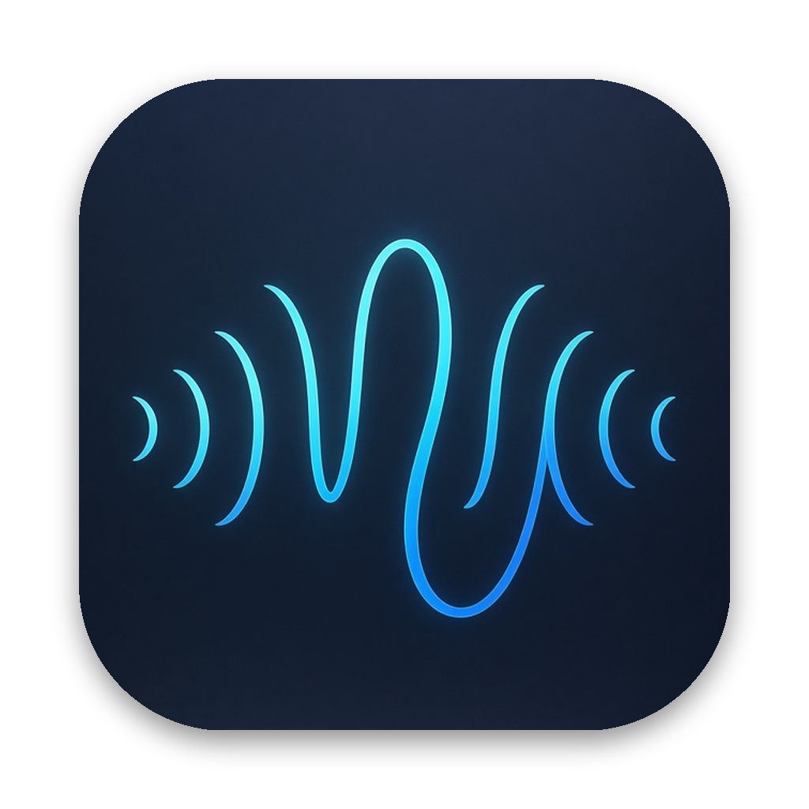
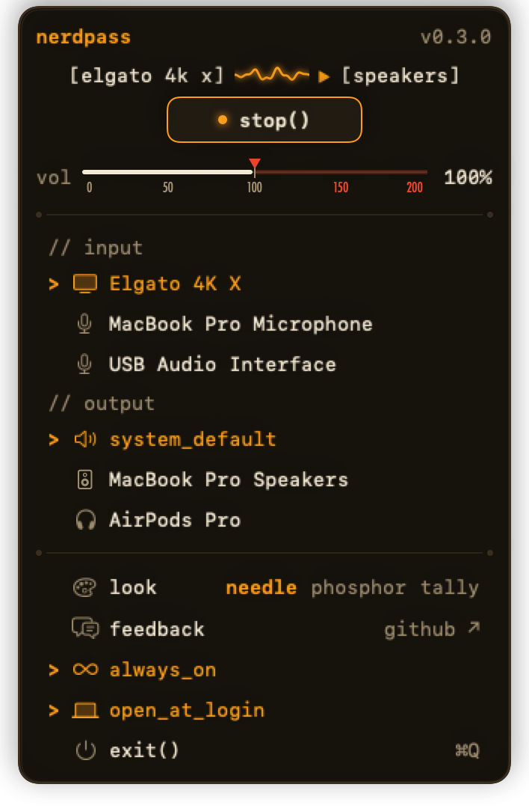
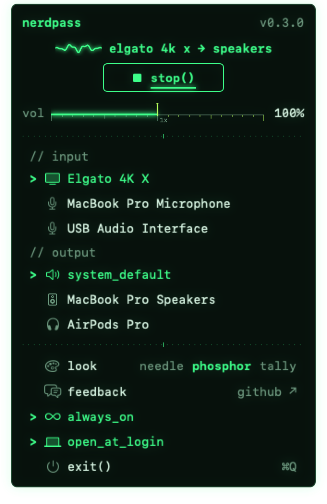
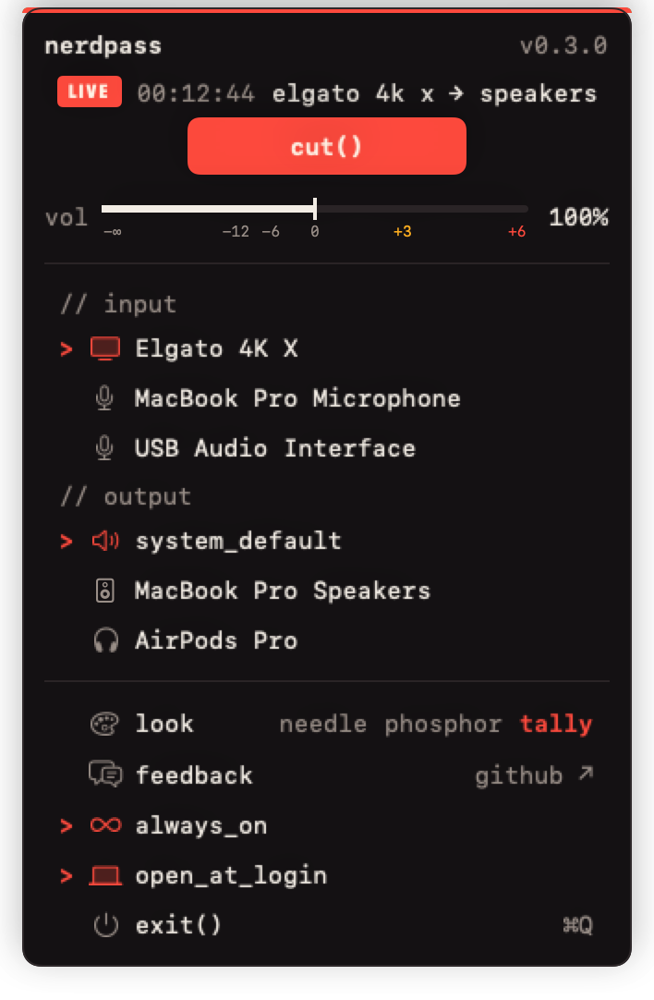

<p align="center"></p>

# Nerdpass

**Hear your capture card through your Mac, from the menu bar.**

Nerdpass is a small, free, open-source macOS menu bar app. Plug a console or camera into a capture card (an Elgato,
an AVerMedia, a cheap USB HDMI dongle) and Nerdpass plays its sound live through your Mac's speakers or headphones,
the way QuickTime's preview does, without a window in your way. Start it, stop it, set its volume, and by default it
opens at login with the sound already on.

Made for the [Nerdative](https://www.youtube.com/@nerdative) channel on YouTube. If you like it, a shoutout
on your stream means a lot.

<p align="center">
  
  
  
</p>

## Features

- **Menu bar only.** No Dock icon, no window. The menu bar icon follows the card's sound while it plays, shows when
  Nerdpass is waiting for the card, and rests (tinted like any other menu bar icon) when stopped. Click it for the
  panel.
- **Three looks.** Pick one under `look` in the panel:
  - **needle** (the default): a backlit analog VU meter on a walnut faceplate. The menu bar icon is a tiny meter
    whose needle swings with the sound, and the panel draws the cable from your card to your speakers with a live
    waveform travelling along it. Starting warms the meter up with a flicker and kicks the needle to +3.
  - **phosphor**: an oscilloscope, green trace on a dark CRT. The menu bar icon is a scope screen with a live trace;
    waiting, a dot hunts along a dashed line. start() sweeps a beam across the panel, and stop() plays the old TV
    power-off.
  - **tally**: a broadcast switcher. take() wipes a red on-air strip across the panel and lights a LIVE chip with a
    clock of how long the card has been on air; cut() switches off in one frame. The menu bar icon is a tally lamp:
    solid red on air, blinking amber on standby. The fader is labelled in dB.
- **Start and stop** with one button (or Space while the panel is open).
- **Volume** from 0 to 200%, 100% by default (the card's own level, at the middle of the control). Below 100% the
  scale follows VLC's cubic curve, so 50% sounds about half as loud. Above 100% Nerdpass boosts the sound, up to 2x
  (+6 dB) at 200%, through a soft clipper (the same one Nerdfader uses) so loud moments are rounded off instead of
  crackling. Each look draws the boost in its own hot color. The meter shows the card's level before the volume.
- **Finds your capture card.** With nothing picked, Nerdpass uses the first input that looks like a capture card.
  Every audio input is listed, so you can pick another one.
- **Pick where the sound goes.** Under `// output` the panel lists every output (speakers, headphones, displays,
  interfaces). `system_default` (the default) follows the Mac's current output from Sound settings or Control
  Center. If the output you picked disconnects, the sound moves to the default output and returns when it is back.
- **Never howls.** If your card is unplugged or switched off, Nerdpass waits for it and picks up again when it is
  back. It never falls back to a microphone, which would feed your speakers back into it.
- **always_on** (on by default): Nerdpass starts the sound every time it opens. Turn it off and Nerdpass opens
  stopped, waiting for you to press start.
- **open_at_login** (on by default): Nerdpass opens when you log in, so with both on your card is audible from the
  moment the Mac starts. Turn either off in the panel and it stays off.
- A `feedback` link straight to GitHub issues.

## Download

**One command** (installs or updates to the latest release):

```bash
curl -fsSL https://raw.githubusercontent.com/grumpitect/nerdpass/main/install.sh | bash
```

[install.sh](install.sh) downloads the latest release, checks its SHA-256 against the one in the release notes, and
puts Nerdpass.app in /Applications (or where it already is). It only uses tools that come with macOS; read it first
if you like. Files downloaded this way aren't flagged by macOS, so there is no "Open Anyway" step.

**With [Homebrew](https://brew.sh):**

```bash
brew tap grumpitect/nerdpass
brew trust grumpitect/nerdpass
brew install --cask nerdpass
```

Homebrew asks you to trust third-party taps once (`brew trust`). `brew upgrade --cask nerdpass` updates it later.

**By hand:** grab the latest **Nerdpass-x.y.z.zip** from [Releases](https://github.com/grumpitect/nerdpass/releases/latest),
unzip it, move **Nerdpass.app** to Applications and open it.

With Homebrew or the zip, macOS says it can't verify the developer the first time (Nerdpass is free and not notarized
by Apple). Open **System Settings > Privacy & Security**, scroll down and click **Open Anyway**. You only need to do
this once.

**Audio input access.** macOS treats a capture card's sound like a microphone, so the first time the sound starts
it asks to let Nerdpass use audio input. Nerdpass only plays the sound to your speakers; nothing is
recorded or sent anywhere. If you said no, the panel shows **allow_audio_input**, which opens the setting.

## Requirements

- macOS 14 Sonoma or later (developed and tested on Apple Silicon; Intel builds are untested)
- A capture card with audio over USB (tested with an Elgato 4K X)
- Xcode or the Xcode Command Line Tools (Swift 5.9+) to build from source

## Build from source

```bash
git clone https://github.com/grumpitect/nerdpass.git
cd nerdpass
./build.sh
```

`build.sh` runs the tests, builds `Nerdpass.app`, and installs it to `~/Applications`. Maintainers publish a release
with `./release.sh` (patch bump by default; `minor`, `major` or an exact `X.Y.Z` also work).

**Keep audio access across rebuilds (optional, for developers).** macOS remembers audio input access per code
signature. Ad hoc builds get a new signature every time, so macOS asks again after each rebuild. A free self-signed
certificate fixes that:

1. Keychain Access > Certificate Assistant > Create a Certificate
2. Name `Nerdpass Signing`, Identity Type **Self Signed Root**, Certificate Type **Code Signing**
3. Build with `SIGN_IDENTITY="Nerdpass Signing" ./build.sh`

## Command line

```bash
~/Applications/Nerdpass.app/Contents/MacOS/Nerdpass --list-inputs                  # audio inputs (★ = capture card) and outputs
~/Applications/Nerdpass.app/Contents/MacOS/Nerdpass --start                        # launch with the sound on, even with always_on off
~/Applications/Nerdpass.app/Contents/MacOS/Nerdpass --snapshot panel.png           # render the panel to an image
~/Applications/Nerdpass.app/Contents/MacOS/Nerdpass --snapshot panel.png --demo --look tally   # made-up inputs, any look
~/Applications/Nerdpass.app/Contents/MacOS/Nerdpass --snapshot-icons icons.png     # every menu bar icon state
~/Applications/Nerdpass.app/Contents/MacOS/Nerdpass --audio-check 8 --volume 200  # play 8 s and print the audio path's health
```

`--audio-check` plays the picked input to the picked output and prints, every second, the frames received and
played, the buffer's delay, dropouts and the level. Quit the menu bar Nerdpass first.

## Development

```bash
swift test      # 44 tests: capture card detection, picking the input and output, start/stop, unplug and replug,
                # always on at launch, volume curve and boost, soft clipper, the output buffer, settings,
                # menu layout, meter scale and needle ballistics, looks (labels, on-air clock, dB scale)
swift build
```

- `Sources/PassCore`: everything testable (choosing the input, the passthrough state, settings, menu model, the
  volume curve and soft clipper, the output buffer, and the meter: level to VU scale, needle spring, warm-up and
  fade).
- `Sources/App`: the AppKit + SwiftUI menu bar app and the audio path: an `AVCaptureSession` delivers the card's
  sound as 48 kHz stereo floats to a short buffer (about 20 ms) that absorbs the difference between the card's
  clock and the output's, and an `AVAudioEngine` plays it through the gain and soft clipper to the picked output.
- `Tools/make_icon.py`: regenerates the VU meter icon (`pip install pillow numpy`, then `python3 Tools/make_icon.py Resources`;
  `python3 Tools/make_icon.py --png docs/nerdpass-icon.png 2048` renders the large README version).

## Feedback

Found a bug or have an idea? Click **feedback** in the panel, or
[open an issue](https://github.com/grumpitect/nerdpass/issues/new/choose).

## License

[MIT](LICENSE).
